# 기업 AI 튜토리얼 Creative Cloud

Creative Cloud에서 AI를 사용하여 아이디어를 발굴하고, 콘텐츠를 제작하고, 크리에이티브 워크플로우를 간소화하는 데 도움이 되는 튜토리얼을 살펴보세요. 튜토리얼은 그래픽 Designer, 크리에이티브/아트 Director, Photoshop 아티스트/리투처, 비디오 편집기 등의 역할별로 그룹화되어 있습니다.

## 그래픽 Designer

<table style="table-layout:fixed">
<tr>
 <td>
   <a href="turn-flat-vector-art.md">
      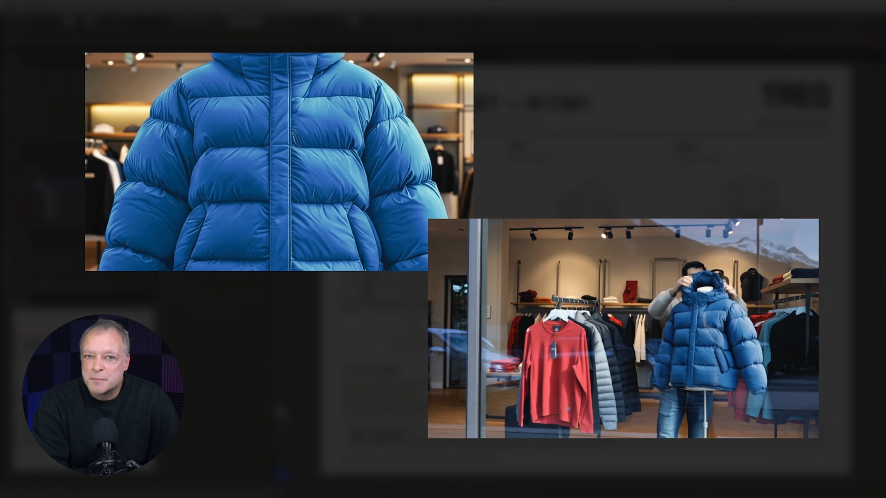
   </a>
    

   <a href="turn-flat-vector-art.md"><strong>플랫 벡터 아트를 다시 그리지 않고 임의의 각도로 전환</strong></a>
    

    <em>Illustrator에서 텍스트를 사용하여 패턴을 만드는 방법 알아보기</em>
     
  </td>
  <td>
   <a href="seamless-vector.md">
      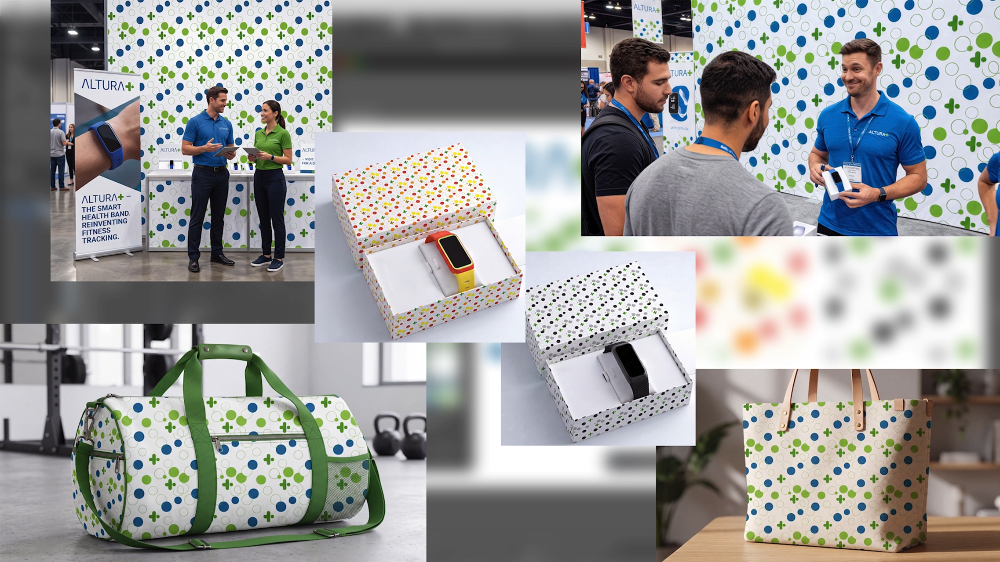
   </a>
    

   <a href="seamless-vector.md"><strong>매끄러운 벡터 패턴을 몇 시간이 아닌 몇 분 안에 제공</strong></a>
    

    <em>모든 반복 가장자리를 일일이 확인하지 않고 Illustrator에서 매끄러운 브랜드 패턴을 만드는 방법을 배워보세요</em>
     
  </td>
  <td>
   <a href="sketch-to-clean.md">
      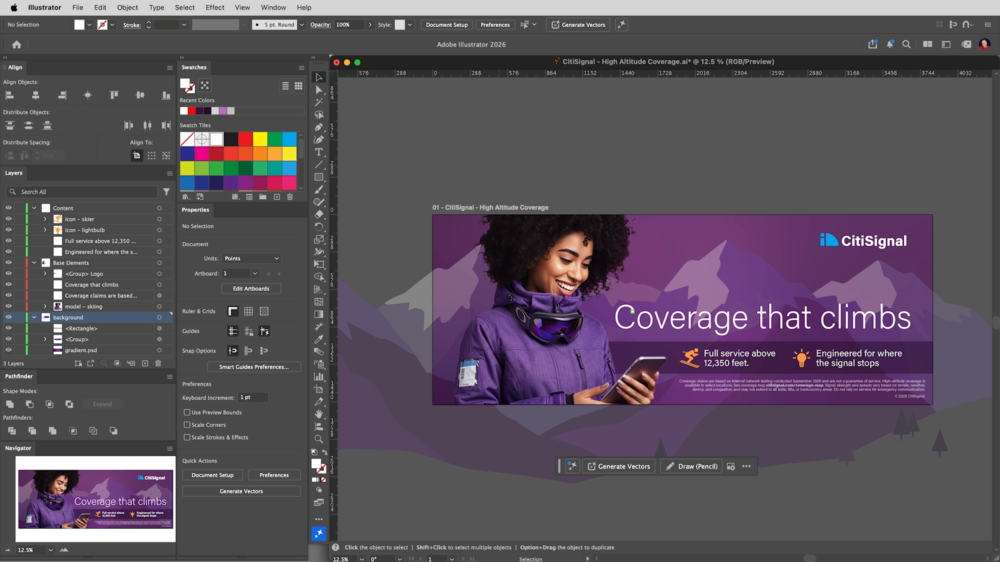
   </a>
    

   <a href="sketch-to-clean.md"><strong>스케치에서 정리되고 편집 가능한 벡터</strong></a>
    

    <em>Illustrator에서 러프 스케치를 편집 가능한 벡터 아트워크로 변환하는 방법에 대해 알아봅니다.</em>
     
  </td>
  <td>
   <a href="vector-to-layout.md">
      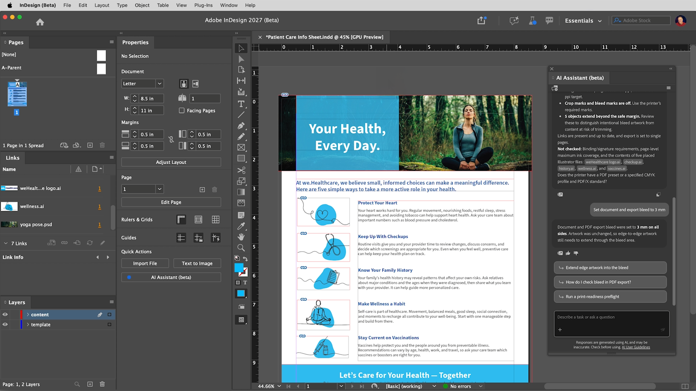
   </a>
    

   <a href="vector-to-layout.md"><strong>벡터 아트를 InDesign 레이아웃으로 이동하고 전달을 위해 패키지화</strong></a>
    

    <em>InDesign의 AI 도우미에 문의하여 인쇄 레이아웃을 확인하는 방법</em>
     
  </td>
</tr>
</table>

## 크리에이티브/아트 Director

<table style="table-layout:fixed">
<tr>
  <td>
   <a href="one-brief.md">
      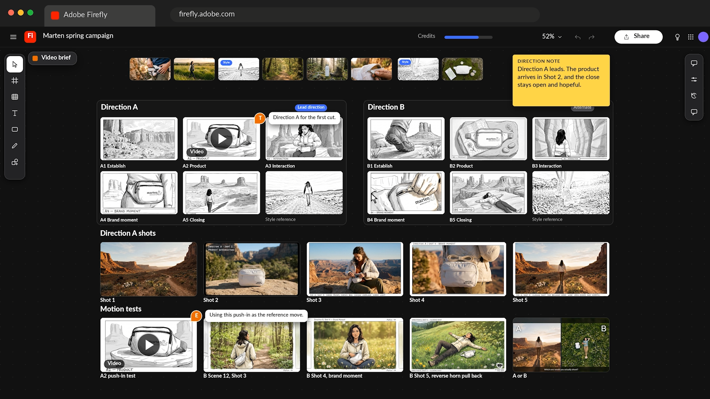
   </a>
    

   <a href="one-brief.md"><strong>점심 전에 한 번의 간단한 지침에서 20개</strong></a>
    

    <em>크리에이티브 브리프를 강력한 시각적 방향의 공유 보드로 변환하는 방법에 대해 알아보세요</em>
     
  </td>
  <td>
   <a href="brief-to-storyboard.md">
      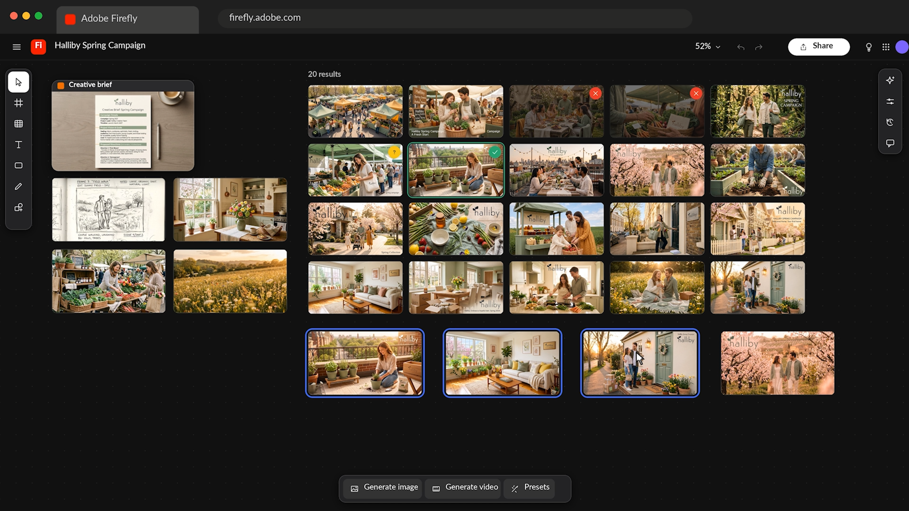
   </a>
    

   <a href="brief-to-storyboard.md"><strong>간단한 내용에서 스토리보드까지: 제작 전에 비디오 방향 살펴보기</strong></a>
    

    <em>크리에이티브 브리프를 강력한 시각적 방향의 공유 보드로 변환하는 방법에 대해 알아보세요</em>
     
  </td>
  <td>
    
    

     
  </td>
  <td>
    
    

     
  </td>
</tr>
</table>

## Photoshop 아티스트/재투처

<table style="table-layout:fixed">
<tr>
  <td>
   <a href="retouch-faster.md">
      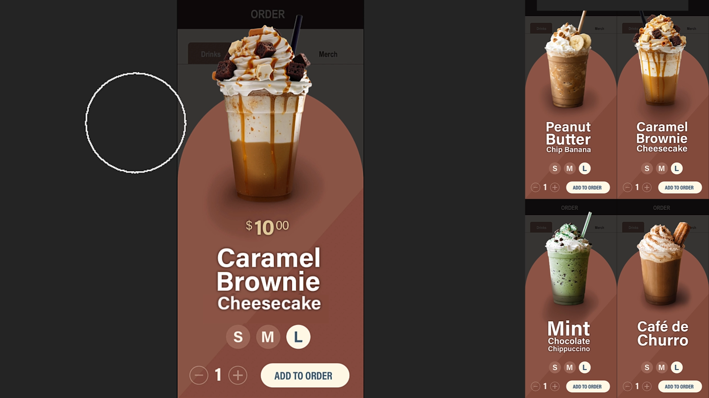
   </a>
    

   <a href="retouch-faster.md"><strong>더 빠르게 수정하고 원래 픽셀을 유지합니다</strong></a>
    

    <em>원본 픽셀을 그대로 유지하면서 Photoshop에서 제품 사진에 자연스러운 그림자를 추가하는 방법을 알아보세요</em>
     
  </td>
  <td>
   <a href="build-presets.md">
      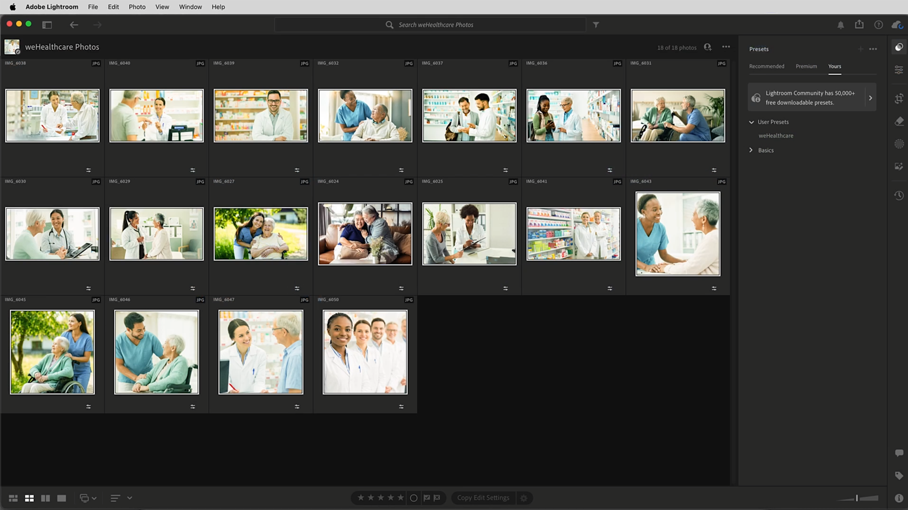
   </a>
    

   <a href="build-presets.md"><strong>촬영 시 일관된 색상을 위한 사전 설정 작성</strong></a>
    

    <em>각 이미지를 하나씩 편집하지 않고 전체 사진을 일관성 있게 보이게 하는 방법을 알아보세요</em>
     
  </td>
  <td>
   <a href="adapt.md">
      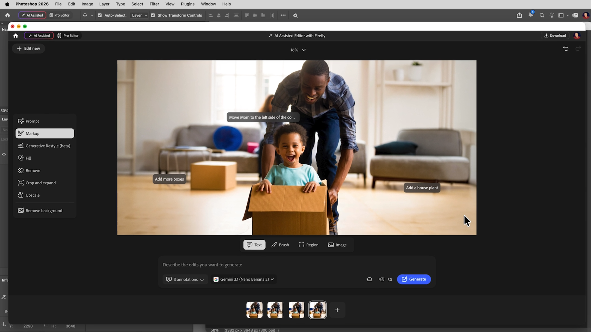
   </a>
    

   <a href="adapt.md"><strong>생성 도구를 사용하여 이미지 정리 및 조정</strong></a>
    

    <em>생성형 확장 및 생성형 채우기 확장을 사용하여 아이디어를 개선하는 방법에 대해 알아보세요</em>
     
  </td>
  <td>
    
    

     
  </td>
</tr>
</table>

## 비디오 편집기

<table style="table-layout:fixed">
<tr>
  <td>
   <a href="fill-gaps.md">
      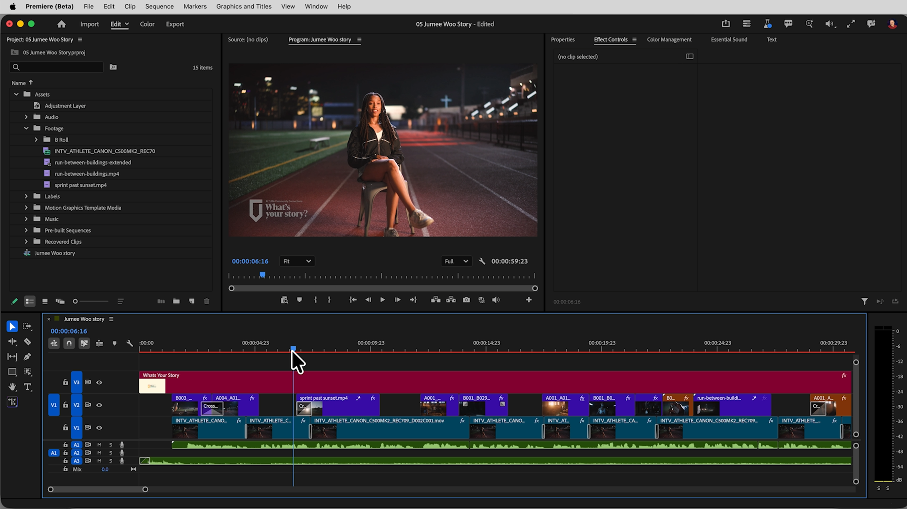
   </a>
    

   <a href="fill-gaps.md"><strong>컷의 간격 채우기: 너무 빨리 끝나는 B-롤, 오디오 및 클립</strong></a>
    

    <em>Premiere에서 생성형 확장을 사용하는 방법 알아보기</em>
     
  </td>
 <td>
   <a href="rough-cut.md">
      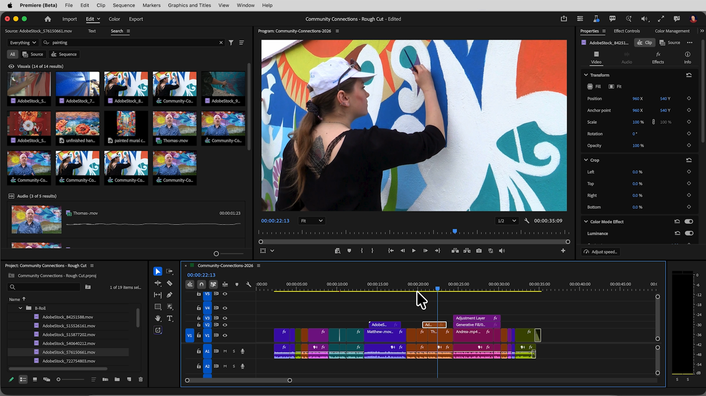
   </a>
    

   <a href="rough-cut.md"><strong>러프 컷에 더 빠르게 이동</strong></a>
    

    <em>모든 클립을 스크러빙하지 않고 인터뷰로부터 러프 컷을 만들고 Premiere에서 더 빠르게 B-롤하는 방법을 알아보세요</em>
     
  </td>
  <td>
   <a href="match-color.md">
      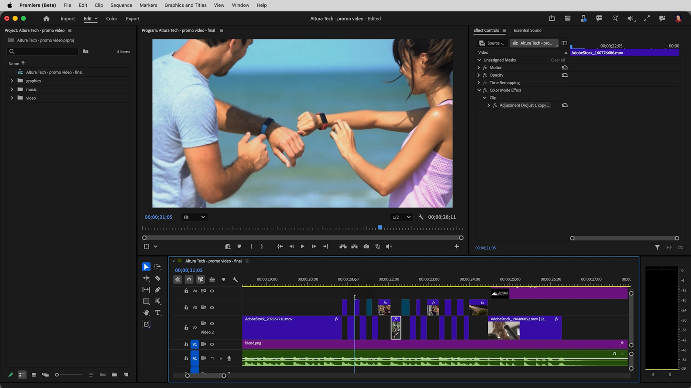
   </a>
    

   <a href="match-color.md"><strong>여러 샷에서 색상을 일치시킵니다. 색상 휠이 필요하지 않습니다.</strong></a>
    

    <em>같은 편집에 속한 것처럼 다르게 조명을 비추는 방법에 대해 알아보세요</em>
     
  </td>
 <td>
   <a href="pull-noise.md">
      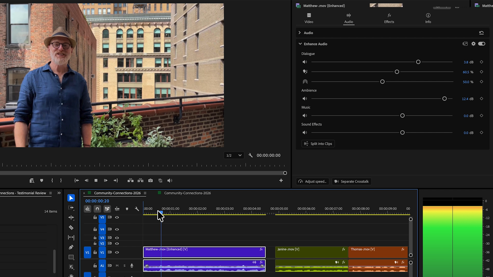
   </a>
    

   <a href="pull-noise.md"><strong>Adobe Premiere의 새로운 기능: 대화, 분위기 및 노이즈를 분리하기</strong></a>
    

    <em>오디오를 분리하여 대화 상자를 복구하는 방법</em>
     
  </td>
</tr>
</table>

