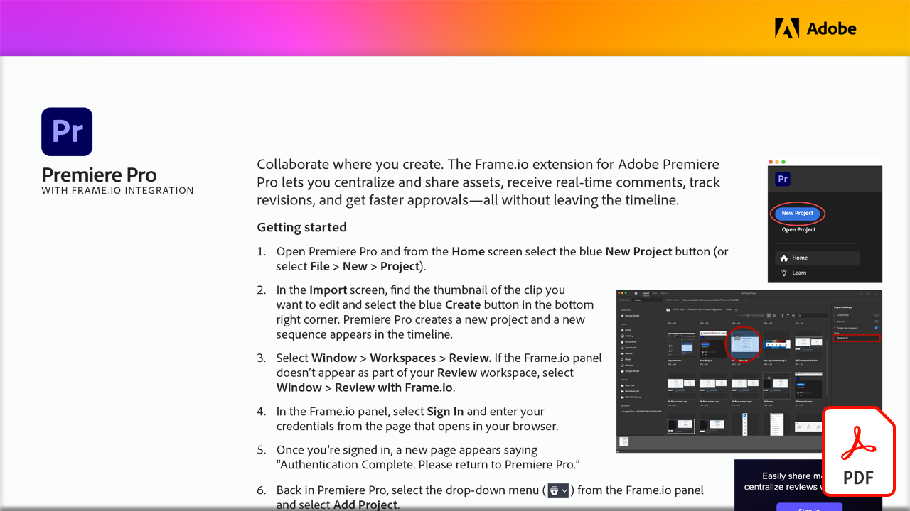

# 프레임.io로 비디오 검토

제작하는 곳에서 공동 작업을 수행할 수 있습니다. Adobe Premiere Pro용 프레임.io 확장을 통해 자산을 중앙 집중화 및 공유하고, 실시간 주석을 수신하고, 수정 사항을 추적하고, 보다 빠르게 승인받는 방법을 이 실습 튜토리얼에서 타임라인을 벗어나지 않고 모두 알아보십시오.

이 PDF 튜토리얼을 보거나 다운로드하려면 아래 이미지를 선택하십시오.

{target="blank"}
