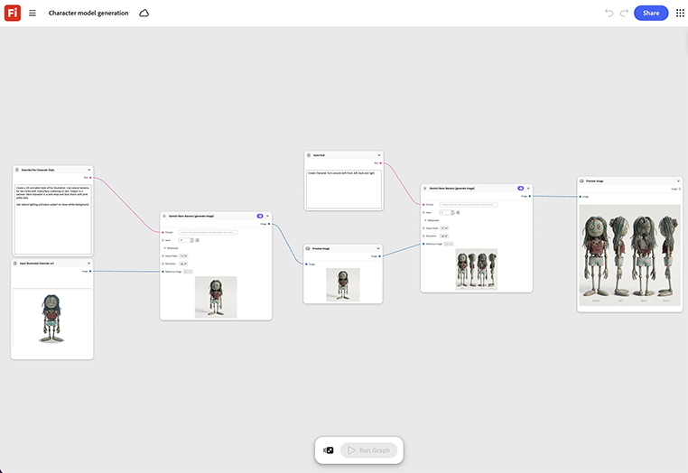

# 문자 모델 생성

일러스트레이션의 3D 애니메이션 스타일을 만드는 방법에 대해 알아봅니다. 템플릿은 빈 장면에서 시작하지 않고 정리를 위해 모델러에게 전달할 기본 3D 모델 패스를 생성합니다.[열린 문자 모델 생성 템플릿](https://firefly.adobe.com/graph/edit/id/urn:aaid:sc:US:4008fbc8-083b-5766-ace9-6abf998df840).

[!BADGE 업계 예]{type=Informative tooltip="업계 예"}

* **야외** - 승인된 단일 캐릭터 브리프에서 시작하여 패키징 렌더링 및 비디오에 사용할 트레일 마스코트 캐릭터의 3D 모델을 빌드합니다.
* **기술** - 정리를 위해 모델러에게 전달할 준비가 된 서면 설명서에서 기본 3D 문자 모델을 생성합니다.
* **교육** - 강의 비디오 수업에 사용할 3D 강사 문자 모델을 빌드합니다.

>[!TIP]
>
>**시작하기 전** - 최상의 결과를 얻으려면 이 템플릿을 나만의 브랜드, 제품 및 워크플로로 사용자 지정하세요. 출력을 사용하기 전에 참조 이미지, 프롬프트 및 사본을 스왑합니다.

{align="center"}

[Firefly Graph 시작하기](https://experienceleague.adobe.com/en/docs/creative-cloud-enterprise-learn/cce-learning-hub/fireflyoverview/firefly-graph/overview-firefly-graph)&#x200B;(으)로 돌아갑니다.
