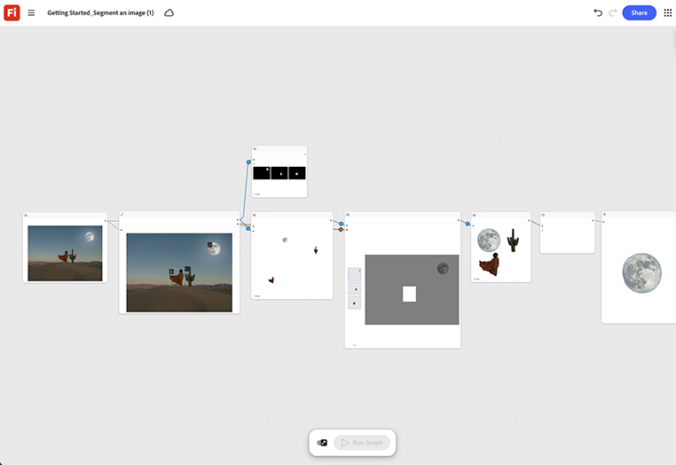

# 시작하기 - 이미지 세그먼트

소스 이미지를 로드하고 분할 노드를 실행하여 피사체를 배경에서 분리하는 방법을 살펴봅니다. [시작하기 열기 - 이미지 템플릿 세그먼트](https://firefly.adobe.com/graph/edit/id/urn:aaid:sc:VA6C2:c090820d-b733-44c7-910d-5e216c19c5cc).

[!BADGE 업계 예]{type=Informative tooltip="업계 예"}

* **건강** - 배경 다시 검사 없이 사용 중인 스튜디오 사진에서 의료 장치를 분할하여 제품 페이지의 깨끗한 임상 배경에 놓습니다.
* **소매** - 깨끗한 제품 전용 카탈로그 이미지를 만들기 위해 라이프스타일 사진에서 의류를 분리합니다.
* **자동차** - 장소 촬영에서 차량을 잘라내어 인쇄용 스튜디오 배경에 배치합니다.

>[!TIP]
>
>**시작하기 전** - 최상의 결과를 얻으려면 이 템플릿을 나만의 브랜드, 제품 및 워크플로로 사용자 지정하세요. 출력을 사용하기 전에 참조 이미지, 프롬프트 및 사본을 스왑합니다.

{align="center"}

[Firefly Graph 시작하기](https://experienceleague.adobe.com/en/docs/creative-cloud-enterprise-learn/cce-learning-hub/fireflyoverview/firefly-graph/overview-firefly-graph)&#x200B;(으)로 돌아갑니다.
