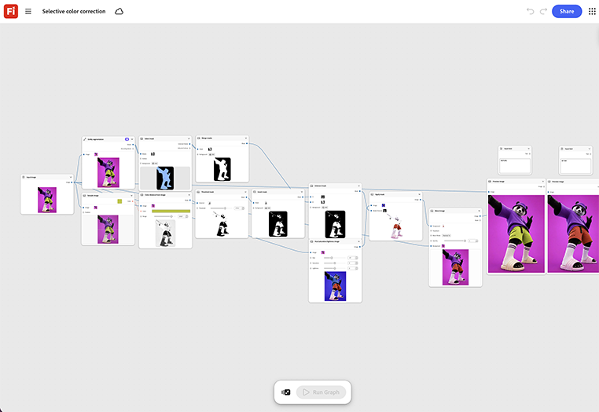

# 선택 색상 교정

수정이 필요한 특정 영역을 마스킹하고 해당 노드의 대상 색상만 설정하는 방법에 대해 알아봅니다. 이미지의 나머지 부분은 그대로 그래프를 통과합니다. [선택 색상 교정 템플릿 열기](https://firefly.adobe.com/graph/edit/id/urn:aaid:sc:US:92c1c93e-4a12-5c99-a2d7-a06ad1662125).

[!BADGE 업계 예]{type=Informative tooltip="업계 예"}

* **통신 및 통신** - 모든 위치가 완전히 다시 변경하지 않고 브랜드의 시그니처 색상과 일치하도록 여러 소매점 사진에서 브랜드 색상을 교정합니다.
* **소매** - 일관되지 않은 조명 하에서 사진 세트 사진 전체에 걸쳐 제품 색상을 표준화합니다.
* **재무** - 게시하기 전에 여러 마케팅 사진에서 흩어진 브랜드 색상을 교정합니다.

>[!TIP]
>
>**시작하기 전** - 최상의 결과를 얻으려면 이 템플릿을 나만의 브랜드, 제품 및 워크플로로 사용자 지정하세요. 출력을 사용하기 전에 참조 이미지, 프롬프트 및 사본을 스왑합니다.

{align="center"}

[Firefly Graph 시작하기](https://experienceleague.adobe.com/en/docs/creative-cloud-enterprise-learn/cce-learning-hub/fireflyoverview/firefly-graph/overview-firefly-graph)&#x200B;(으)로 돌아갑니다.
